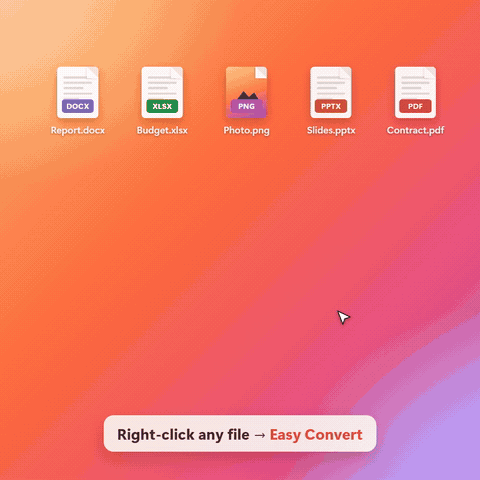
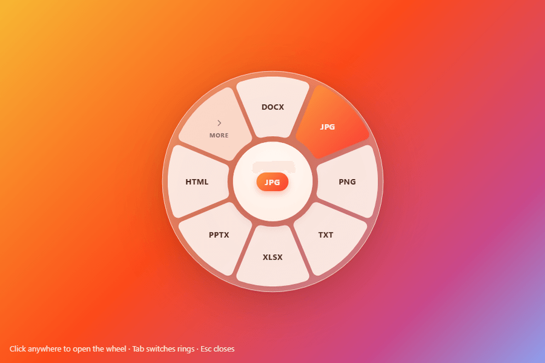
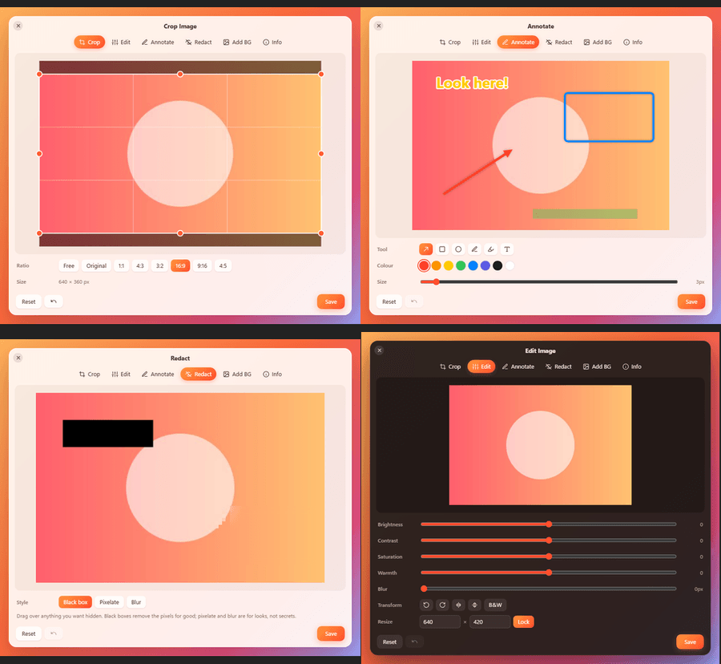
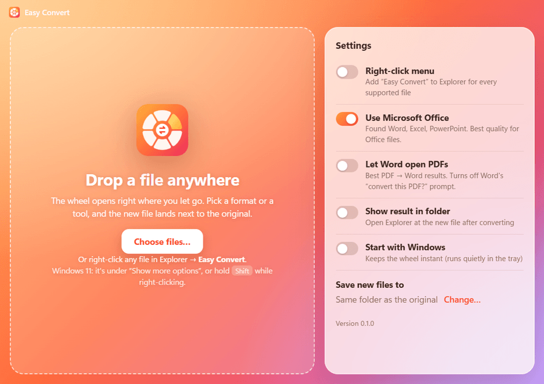
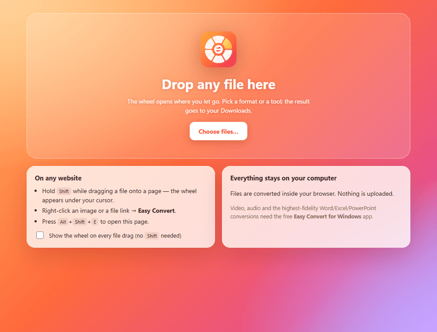
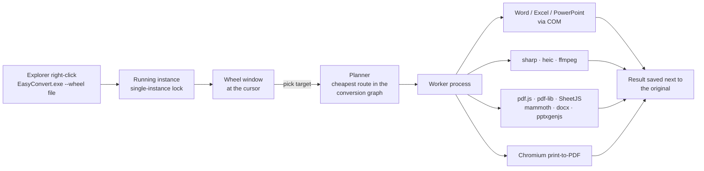

<div align="center">



# Easy Convert

**Right-click any file. Pick a format from a wheel. Done.**

A Windows app and a Chrome extension that convert *anything to anything*:
Word ↔ PDF, PDF → Word, Excel → Word/PDF, PowerPoint → PDF/images/video, HEIC → JPG, images → PDF, video → MP3/GIF, and more,
plus quick tools like Crop, Add Background, Redact, Annotate and Compress.

[▶ Watch the 25-second demo](docs/easy-convert-promo.mp4) ·
[Download for Windows](https://github.com/AMIRAK-code/easy-converter-ext-desktop-app/releases/latest) ·
[Chrome extension](#chrome-extension)


-ff6a3d)


</div>

---

## Why

Converting a file usually means hunting for a website, uploading something private and waiting.
Easy Convert puts every conversion one right-click away, and nothing leaves your computer.

<table>
<tr>
<td width="50%"></td>
<td width="50%"></td>
</tr>
<tr>
<td align="center"><b>Convert ring:</b> every format this file can become</td>
<td align="center"><b>Tools ring:</b> click the hub (or press <kbd>Tab</kbd>) to switch</td>
</tr>
</table>

## Features

- **Radial wheel**: opens right under your cursor. Hover a petal, click, and the result lands next to the original (`Report.docx` → `Report.pdf`, `Photo.png` → `Photo Cropped.png`).
- **Anything → anything**: converters are linked in a graph, and Easy Convert picks the best chain automatically. For example, Excel → Word goes *Excel → HTML (keeps formatting) → Word*, and Word → JPG goes *Word → PDF → image*.
- **Office-grade quality**: when Microsoft Office is installed, Word, Excel and PowerPoint do the conversion invisibly through COM, so the output is identical to "Save As" in Office. Without Office, built-in converters take over.
- **Built-in editor**: Crop (with aspect ratios), Edit (brightness, contrast, saturation, warmth, blur, rotate, flip, resize), Annotate (arrows, boxes, circles, pen, marker, text), Redact (black box, pixelate, blur) and **Add BG** (gradient or solid backgrounds, padding, rounded corners, shadow, aspect ratio). It's perfect for screenshots.
- **More tools**: Compress (images, PDFs, video, audio and even the pictures inside DOCX/XLSX/PPTX), strip metadata (GPS, camera), rotate and split PDFs, merge any mix of files into one PDF, mute video, grab a snapshot, normalize audio loudness.
- **Batch**: select up to 15 files in Explorer, and the wheel offers what they have in common.
- **Private**: everything runs on your machine. No uploads, no accounts, no telemetry.



## What converts to what

| From | To |
| --- | --- |
| **Word** (DOCX, DOC, RTF, ODT) | PDF, DOCX/DOC/RTF/ODT, TXT, HTML, Markdown, XLSX (tables), PPTX, JPG/PNG/WEBP/TIFF (pages), XPS |
| **PDF** | Word (DOCX/DOC/RTF/ODT), Excel (XLSX/CSV, tables detected), PowerPoint, JPG/PNG/WEBP/TIFF (one per page), TXT, HTML, Markdown |
| **Excel** (XLSX, XLS, XLSM, XLSB, ODS) | PDF, Word, CSV, TSV, JSON, HTML, Markdown, XLS/ODS, images |
| **CSV / JSON** | XLSX, CSV/TSV/JSON, PDF, Word, HTML, Markdown |
| **PowerPoint** (PPTX, PPT, ODP) | PDF, PNG/JPG (one per slide), **MP4 video**, Word, PPT/ODP, XPS |
| **Markdown / TXT / HTML** | PDF, Word, HTML, Markdown, TXT, Excel (tables), images |
| **Images** (JPG, PNG, WEBP, AVIF, **HEIC**, TIFF, GIF, BMP, ICO, SVG) | each other, plus PDF, Word, PowerPoint, ICO (multi-size) |
| **Video** (MP4, MOV, WEBM, MKV, AVI, WMV) | each other, GIF, MP3/WAV/M4A/OGG/FLAC/OPUS/AAC/WMA |
| **Audio** (MP3, WAV, M4A, AAC, OGG, FLAC, OPUS, WMA) | each other |

## Windows app



### Install

1. Download **Easy-Convert-Setup.exe** from [Releases](https://github.com/AMIRAK-code/easy-converter-ext-desktop-app/releases/latest) and run it. It installs per-user, so no admin rights are needed.
2. Right-click any file in Explorer → **Easy Convert**.
   On Windows 11 it's under **Show more options**, or hold <kbd>Shift</kbd> while right-clicking.

> The installer isn't code-signed yet, so Windows SmartScreen may warn you the first time. Click **More info → Run anyway**.

### Use

| Do this | To |
| --- | --- |
| Right-click a file → **Easy Convert** | Open the wheel at the cursor |
| Hover + click a petal, or use arrow keys + <kbd>Enter</kbd>, or press <kbd>1</kbd>–<kbd>8</kbd> | Convert |
| Click the hub, or press <kbd>Tab</kbd> / scroll | Switch between **Convert** and **Tools** |
| **More** petal | See every other format |
| <kbd>Esc</kbd> or click outside | Close |
| Drop files on the Easy Convert window | Same wheel, where you drop them |

Settings (in the app window): right-click menu on/off, use Microsoft Office, let Word open PDFs (best PDF → Word), show result in folder, start with Windows, output folder.

## Chrome extension



- **Shift + drag** a file from your computer onto any web page. The wheel appears under the cursor; drop on a format.
- **Right-click** an image or a link to a file (PDF, DOCX, XLSX, …) → **Easy Convert**.
- Click the toolbar icon (or <kbd>Alt</kbd>+<kbd>Shift</kbd>+<kbd>E</kbd>) for a full-page drop zone.

Everything converts inside the browser (pdf.js, SheetJS, mammoth, docx, pdf-lib) and results go to your Downloads.
Video/audio and the Office-perfect conversions need the Windows app.

**Install (developer mode)**: download `easy-convert-extension.zip` from [Releases](https://github.com/AMIRAK-code/easy-converter-ext-desktop-app/releases/latest) and unzip it. Open `chrome://extensions`, turn on **Developer mode**, click **Load unpacked**, and pick the folder.

## How it works



- **One planner, two engines.** `src/shared/graph.js` finds the cheapest chain of converters (up to 3 hops). The desktop engine registers native converters; the extension registers browser ones. Both share the wheel, the editor and the document logic in `src/shared`.
- **Office safety.** Office runs hidden through a PowerShell script with paths passed as arguments, never interpolated into code. If Office was already open it's shared and never closed. If Office stalls, the job is re-routed through the built-in converters automatically.
- **Responsive.** Conversions run in an Electron utility process, so the wheel never freezes.

## Build from source

```bash
npm install
npm start                 # run the Windows app (dev)
npm run menu:install      # add the Explorer right-click entry for the dev build
npm run build:ext         # build the Chrome extension into dist/extension
npm run dist:win          # build the Windows installer into dist/installer
npm test                  # unit tests
npm run test:matrix       # convert sample files to every target (no Office)
```

There's also a command-line converter:

```bash
npm run convert -- report.docx pdf
npm run convert -- budget.xlsx --list
npm run convert -- a.jpg b.png c.pdf --tool merge
```

```
src/
  shared/      formats, conversion graph, wheel UI, image editor, document/spreadsheet/PDF logic
  desktop/     Electron main, worker, Office bridge, native converters, Explorer menu, UI pages
  web/         browser conversion engine for the extension (+ HTML → PDF layout)
  extension/   manifest, service worker, content script, in-page overlay, app & editor pages
test/          unit tests, fixtures, conversion matrices
```

## Known limitations

- On Windows 11 the entry sits under **Show more options**. Getting into the compact menu needs a signed MSIX package (planned).
- When Office does the conversion, Office talks to your default printer to lay out pages. If that printer is offline you may see a brief *"waiting for printer"* notice. Turn **Use Microsoft Office** off to always use the built-in converters.
- The built-in PDF → Word rebuilds headings, paragraphs, lists and tables from the text layer. Turn on **Let Word open PDFs** for Word's own, higher-fidelity reflow. Scanned PDFs (no text layer) need OCR, which isn't included yet.
- The extension's HTML → PDF uses standard PDF fonts (Latin scripts).

## Credits & licenses

Easy Convert is MIT-licensed. It builds on great open-source projects: Electron, sharp/libvips, FFmpeg (GPL build via `ffmpeg-static`, shipped as a separate executable), libheif (`heic-convert`), pdf.js, pdf-lib, SheetJS, mammoth, docx, pptxgenjs, marked, turndown and htmlparser2. Each is under its own license.

Inspired by a macOS drag-and-drop converter concept shared by [@metav3rse](https://www.instagram.com/metav3rse/).

Made by **Amir Akbari** · [github.com/AMIRAK-code](https://github.com/AMIRAK-code)
